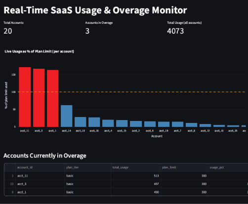

# SaaS Usage Overage Detector

**Real-time usage monitoring and overage detection for usage-based SaaS billing.**

Tracks per-customer API usage as it happens, flags accounts that are about to exceed their plan's included limit, and surfaces it on a live dashboard and Slack alert — instead of discovering revenue leakage at month-end invoicing.

[](https://www.python.org/)
[](https://spark.apache.org/)
[](https://kafka.apache.org/)
[](https://www.postgresql.org/)
[](https://streamlit.io/)
[](LICENSE)

---

## The Problem

Most usage-based SaaS products (API calls, seats, compute credits) only reconcile usage against billing limits in a monthly batch job. By the time an account's overage is discovered, the business has already absorbed weeks of unbilled cost, or a customer gets an unpleasant surprise invoice. This project closes that gap with a streaming pipeline that evaluates usage continuously, not monthly.

## Demo

<!-- Replace with an actual screenshot or GIF of the dashboard before publishing -->


*Live dashboard: usage shown as % of each account's plan limit, with accounts in overage highlighted in red.*

## Architecture

```
Simulated Usage Events (Python)
            │
            ▼
      Apache Kafka                  ← durable, decoupled ingestion
            │
            ▼
Spark Structured Streaming          ← windowed aggregation, watermarking
            │                          for late/out-of-order events
            ▼
       PostgreSQL                   ← running usage totals, overage flags,
            │                          audit history
   ┌────────┴────────┐
   ▼                 ▼
Slack Alerts     Streamlit Dashboard
(real-time)      (live, auto-refreshing)
```

## Key Features

- **Real-time ingestion** — simulated API usage events streamed continuously through Kafka, including randomized usage spikes and late-arriving events to mirror real-world data quality issues
- **Stateful stream processing** — Spark Structured Streaming computes rolling per-account usage totals with watermarking to correctly handle out-of-order data
- **Automatic overage detection** — accounts are flagged the moment their usage crosses their plan's included limit, not at the next billing cycle
- **Live alerting** — Slack notifications fire within seconds of an overage being detected
- **Live dashboard** — a Streamlit + Plotly dashboard shows usage as % of plan limit per account, auto-refreshing every few seconds

## Tech Stack

| Layer | Technology |
|---|---|
| Event generation | Python |
| Message bus | Apache Kafka |
| Stream processing | Apache Spark (Structured Streaming) |
| Storage | PostgreSQL |
| Alerting | Slack Incoming Webhooks |
| Dashboard | Streamlit + Plotly |
| Infra | Docker |

## Repository Structure

```
saas-usage-overage-detector/
├── README.md                  # you are here
├── requirements.txt           # Python dependencies
├── docker-compose.yml         # spins up Kafka + Postgres
├── producer/
│   └── generator.py           # simulated usage event generator
│
├── streaming/
│   └── stream_processing.py   # Spark Structured Streaming job
│
├── storage/
│   └── schema.sql             # Postgres table definition
│
├── alerting/
│   └── alert_watcher.py       # polls Postgres, sends Slack alerts
│
├── dashboard/
    └── dashboard.py           # live Streamlit dashboard

```

## Getting Started

**Prerequisites:** Docker, Python 3.11+, Java 17 (required by Spark)

```bash
# 1. Clone and set up a virtual environment
git clone https://github.com/<your-username>/saas-usage-overage-detector.git
cd saas-usage-overage-detector
python -m venv venv && source venv/bin/activate   # Windows: venv\Scripts\activate
pip install -r requirements.txt

# 2. Start Kafka and Postgres
docker-compose up -d

# 3. Create the database schema
docker exec -it usage-db psql -U postgres -f storage/schema.sql

# 4. Run each component in its own terminal
python producer/generator.py
python streaming/stream_processing.py
python alerting/alert_watcher.py
streamlit run dashboard/dashboard.py
```


## What This Project Demonstrates

- Designing and reasoning about a streaming (not batch) architecture, including *why* real-time processing is the right tool for this problem
- Handling the two hardest parts of stream processing in practice: late/out-of-order events (watermarking) and stateful windowed aggregation
- Connecting a streaming pipeline to durable storage and a real action layer (alerting + dashboard), not just a reporting job
- Debugging and resolving real environment/dependency issues (JVM/Spark version compatibility, connector version matching, local performance tuning) rather than only working against a pre-built tutorial stack

## Future Improvements

- Schema registry (Avro/Protobuf) for safe schema evolution
- Exactly-once processing guarantees (transactional Kafka writes + idempotent Postgres upserts)
- Kafka partitioning strategy for horizontal scaling by `account_id`
- Proper secrets management instead of local `.env` values
- Dead-letter queue for malformed events

## Author

**Bhavin Prajapati**
[GitHub](https://github.com/<your-username>) · [LinkedIn](https://linkedin.com/in/<your-profile>) · prajapatibhavin2005@gmail.com
